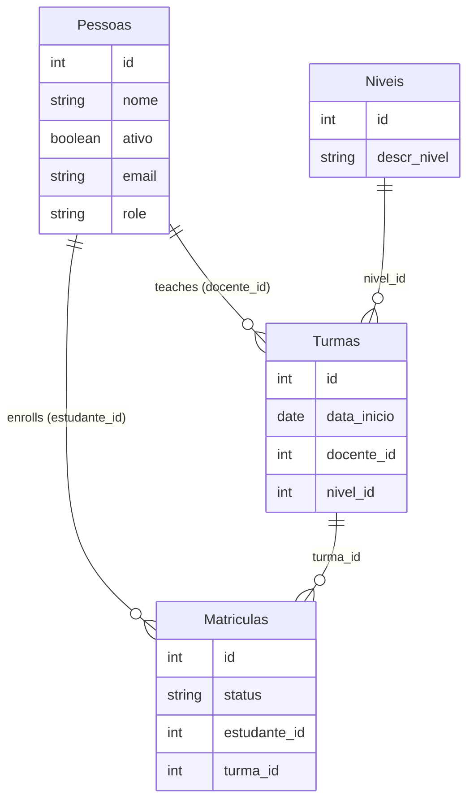

<div align="center">

# english-school-api

**REST API for an English school, built with Express and the Sequelize ORM on MySQL.**


</div>

**English** · [Português](README.pt-BR.md)

> [!NOTE]
> Built during [Alura](https://www.alura.com.br/)'s ORM courses with Node.js and Sequelize. The domain (routes, models and fields) and the code comments are in Portuguese. The step-by-step study notes are in [`cmds.txt`](cmds.txt).

---

## About

The API manages the school's people (students and teachers), levels, classes and enrollments. On top of the basic CRUD, it implements a set of business rules requested by a fictional client, each solved with a different Sequelize feature.

## Data model



The tables are created and versioned with **migrations**, and the initial data comes from **seeders**, both via `sequelize-cli`.

## Business rules and how they were solved

| Requirement | Solution |
|---|---|
| Records must never be permanently deleted | **Soft delete** with `paranoid: true` and a `deletedAt` column added by a migration. Every resource has a restore route |
| List only active people by default | Model **`defaultScope`** (`ativo: true`), plus a `todos` scope to list everyone |
| Don't trust validation done only on the front end | **Model validations**: `isEmail` and a custom validator for the name length |
| Quickly look up a student's confirmed enrollments | **Association scope** (`aulasMatriculadas`, filtering `status: 'confirmado'`) |
| Filter classes by date range | `where` with `Op.gte` / `Op.lte` operators on `data_inicio` |
| See enrollments per class and which classes are full | `findAndCountAll` with pagination, and `group` + `having` to find the full ones |
| Deactivating a student cancels all of their enrollments | Both updates run inside a **transaction**: if one fails, the other is rolled back |

Database access is also being moved into a **services layer** (a generic `Services` class plus one specialized service per model), started at the end of the course.

## Routes

<details>
<summary><strong>Full list</strong></summary>

| Method | Route | Description |
|---|---|---|
| `GET` | `/pessoas` | All people, including inactive ones |
| `GET` | `/pessoas/ativas` | Active people only |
| `GET` | `/pessoas/:id` | One person |
| `POST` | `/pessoas` | Creates a person |
| `PUT` | `/pessoas/:id` | Updates a person |
| `DELETE` | `/pessoas/:id` | Soft-deletes a person |
| `POST` | `/pessoas/:id/restaura` | Restores a deleted person |
| `POST` | `/pessoas/:estudanteId/cancela` | Deactivates a student and cancels their enrollments |
| `GET` | `/pessoas/:estudanteId/matricula` | A student's confirmed enrollments |
| `GET` | `/pessoas/:estudanteId/matricula/:matriculaId` | One enrollment |
| `POST` | `/pessoas/:estudanteId/matricula` | Creates an enrollment |
| `PUT` | `/pessoas/:estudanteId/matricula/:matriculaId` | Updates an enrollment |
| `DELETE` | `/pessoas/:estudanteId/matricula/:matriculaId` | Removes an enrollment |
| `POST` | `/pessoas/:estudanteId/matricula/:matriculaId/restaura` | Restores an enrollment |
| `GET` | `/pessoas/matricula/:turmaId/confirmadas` | Confirmed enrollments in a class |
| `GET` | `/pessoas/matricula/lotada` | Full classes |
| `GET` | `/turmas?data_inicial=&data_final=` | Classes, with optional date filter |
| `GET` / `POST` / `PUT` / `DELETE` | `/turmas`, `/turmas/:id` | Class CRUD |
| `POST` | `/turmas/:id/restaura` | Restores a class |
| `GET` / `POST` / `PUT` / `DELETE` | `/niveis`, `/niveis/:id` | Level CRUD |
| `POST` | `/niveis/:id/restaura` | Restores a level |

</details>

## Running locally

Requirements: Node.js 18+ and MySQL.

```bash
git clone https://github.com/giobroliatto/english-school-api.git
cd english-school-api
npm install
```

Set your MySQL user and password under `development` in [`api/config/config.json`](api/config/config.json) and create the `escola_ingles` database. Then:

```bash
npx sequelize-cli db:migrate
npx sequelize-cli db:seed:all
npm start
```

The API runs at http://localhost:3000.

## Structure

```
api/
├── config/        # Database connection (sequelize-cli)
├── migrations/    # Table creation and changes
├── seeders/       # Sample data
├── models/        # Models, scopes, validations and associations
├── services/      # Database access layer
├── controllers/   # Business rules
└── routes/        # Routes per resource
arquivos-base/     # Course base files and the database diagram (PDF)
```

---

## Author

Made by **Giovani Broliatto**.

[](https://www.linkedin.com/in/giobroliatto/)
