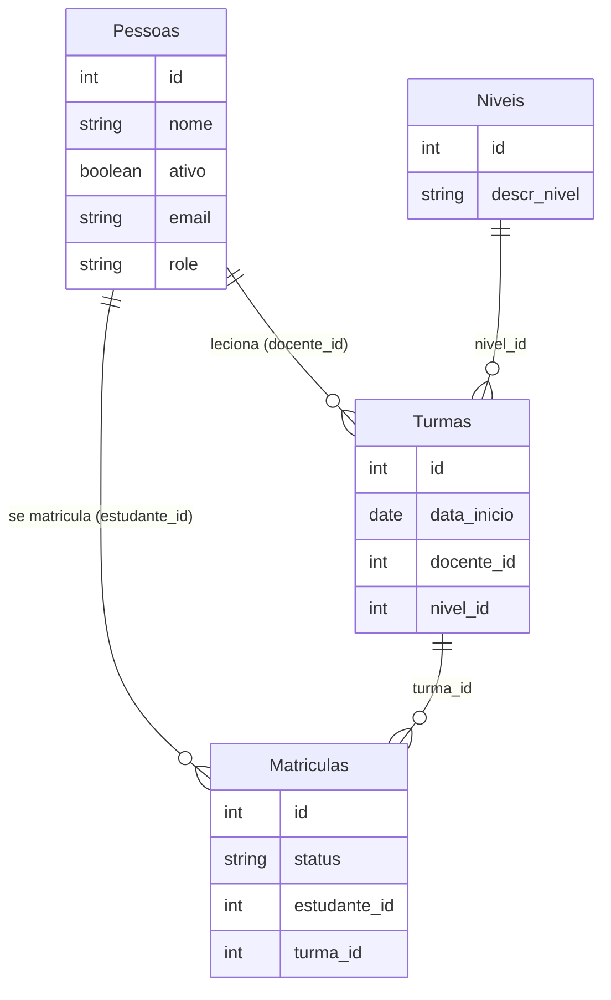

<div align="center">


# english-school-api

**API REST de uma escola de inglês, com Express e o ORM Sequelize sobre MySQL.**


</div>

[English](README.md) · **Português**

> [!NOTE]
> Projeto desenvolvido durante os cursos de ORM com Node.js e Sequelize da [Alura](https://www.alura.com.br/). As anotações de estudo, passo a passo, estão em [`cmds.txt`](cmds.txt).

---

## Sobre

A API gerencia as pessoas da escola (estudantes e docentes), os níveis, as turmas e as matrículas. Além do CRUD básico, ela implementa uma série de regras de negócio pedidas por um cliente fictício, cada uma resolvida com um recurso diferente do Sequelize.

## Modelo de dados



As tabelas são criadas e versionadas com **migrations**, e os dados iniciais vêm de **seeders**, tudo pelo `sequelize-cli`.

## Regras de negócio e como foram resolvidas

| Requisito | Solução |
|---|---|
| Registros não podem ser apagados de vez | **Soft delete** com `paranoid: true` e coluna `deletedAt` criada por migration. Todo recurso tem rota de restauração |
| Listar só pessoas ativas por padrão | **`defaultScope`** no model (`ativo: true`), e um escopo `todos` para listar todo mundo |
| Não depender só da validação do front | **Validações no model**: `isEmail` e um validador customizado para o tamanho do nome |
| Consultar rápido as matrículas confirmadas de um estudante | **Escopo de associação** (`aulasMatriculadas`, filtrando `status: 'confirmado'`) |
| Filtrar turmas por intervalo de datas | `where` com os operadores `Op.gte` / `Op.lte` em `data_inicio` |
| Ver matrículas por turma e quais turmas estão lotadas | `findAndCountAll` com paginação, e `group` + `having` para achar as lotadas |
| Desativar um estudante cancela todas as matrículas dele | As duas atualizações rodam numa **transação**: se uma falhar, a outra é desfeita |

O acesso ao banco também está sendo movido para uma **camada de services** (uma classe `Services` genérica e um service específico por model), iniciada no fim do curso.

## Rotas

<details>
<summary><strong>Lista completa</strong></summary>

| Método | Rota | Descrição |
|---|---|---|
| `GET` | `/pessoas` | Todas as pessoas, inclusive inativas |
| `GET` | `/pessoas/ativas` | Só as pessoas ativas |
| `GET` | `/pessoas/:id` | Uma pessoa |
| `POST` | `/pessoas` | Cria uma pessoa |
| `PUT` | `/pessoas/:id` | Atualiza uma pessoa |
| `DELETE` | `/pessoas/:id` | Apaga uma pessoa (soft delete) |
| `POST` | `/pessoas/:id/restaura` | Restaura uma pessoa apagada |
| `POST` | `/pessoas/:estudanteId/cancela` | Desativa o estudante e cancela as matrículas dele |
| `GET` | `/pessoas/:estudanteId/matricula` | Matrículas confirmadas de um estudante |
| `GET` | `/pessoas/:estudanteId/matricula/:matriculaId` | Uma matrícula |
| `POST` | `/pessoas/:estudanteId/matricula` | Cria uma matrícula |
| `PUT` | `/pessoas/:estudanteId/matricula/:matriculaId` | Atualiza uma matrícula |
| `DELETE` | `/pessoas/:estudanteId/matricula/:matriculaId` | Remove uma matrícula |
| `POST` | `/pessoas/:estudanteId/matricula/:matriculaId/restaura` | Restaura uma matrícula |
| `GET` | `/pessoas/matricula/:turmaId/confirmadas` | Matrículas confirmadas de uma turma |
| `GET` | `/pessoas/matricula/lotada` | Turmas lotadas |
| `GET` | `/turmas?data_inicial=&data_final=` | Turmas, com filtro opcional por data |
| `GET` / `POST` / `PUT` / `DELETE` | `/turmas`, `/turmas/:id` | CRUD de turmas |
| `POST` | `/turmas/:id/restaura` | Restaura uma turma |
| `GET` / `POST` / `PUT` / `DELETE` | `/niveis`, `/niveis/:id` | CRUD de níveis |
| `POST` | `/niveis/:id/restaura` | Restaura um nível |

</details>

## Rodando localmente

Pré-requisitos: Node.js 18+ e MySQL.

```bash
git clone https://github.com/giobroliatto/english-school-api.git
cd english-school-api
npm install
```

Ajuste usuário e senha do MySQL em `development` no [`api/config/config.json`](api/config/config.json) e crie o banco `escola_ingles`. Depois:

```bash
npx sequelize-cli db:migrate
npx sequelize-cli db:seed:all
npm start
```

A API sobe em http://localhost:3000.

## Estrutura

```
api/
├── config/        # Conexão com o banco (sequelize-cli)
├── migrations/    # Criação e alteração das tabelas
├── seeders/       # Dados de exemplo
├── models/        # Models, escopos, validações e associações
├── services/      # Camada de acesso ao banco
├── controllers/   # Regras de negócio
└── routes/        # Rotas por recurso
arquivos-base/     # Arquivos-base do curso e o diagrama do banco (PDF)
```

---

## Autor

Feito por **Giovani Broliatto**.

[](https://www.linkedin.com/in/giobroliatto/)
